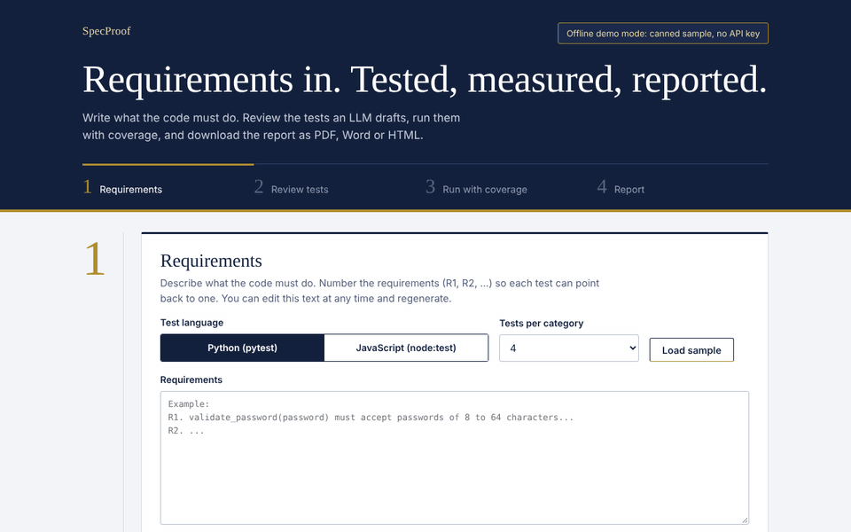
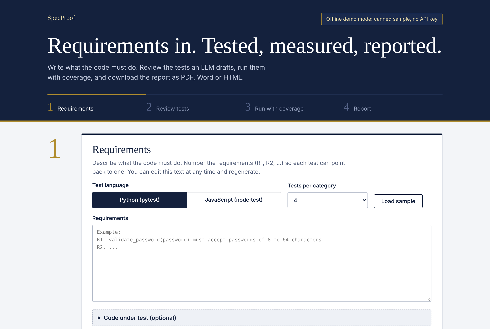
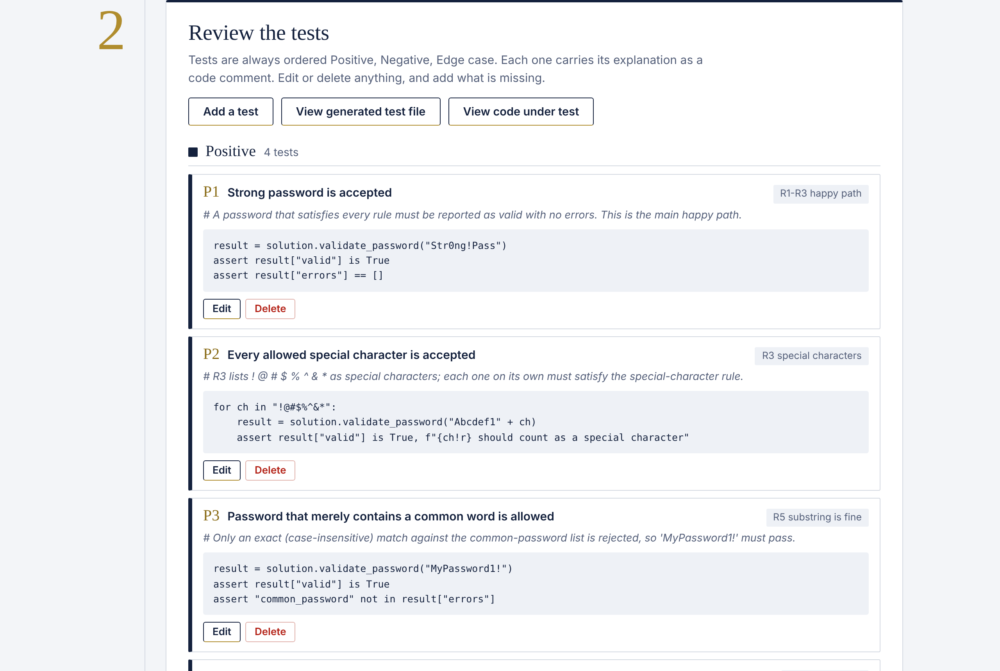

# SpecProof: AI Test Case Generator with Automated Execution

[](https://github.com/easieminion/ai-test-case-generator/actions/workflows/tests.yml)

[](LICENSE)

**Paste requirements. Get reviewed, executed tests with coverage and a PDF report.**

An LLM drafts test cases in **Python (pytest) or JavaScript (node:test)**, ordered positive → negative → edge, each tied to a requirement and explained in a comment. You review and edit them, then the app runs them, measures coverage, and writes a **PDF, Word or HTML** report with charts.



In the demo, the sample password validator has a deliberate off-by-one bug. The generated edge-case test *"Exactly 64 characters is accepted"* catches it: 14 passed, 1 failed, 96.2% statement coverage.

## Try it in 30 seconds (no API key needed)

```bash
git clone https://github.com/easieminion/ai-test-case-generator && cd ai-test-case-generator
pip install -r requirements.txt
python app.py                  # open http://127.0.0.1:5000, click Load sample → Generate tests → Run tests
```

Without `ANTHROPIC_API_KEY` the app runs in a clearly labelled **offline demo mode** that replays a canned suite for the bundled sample, so everything above works offline. Set the key to generate tests for your own requirements.

## Why it's built this way (a QA view)

- **A human stays in the loop.** AI can write wrong tests, so nothing runs until you have reviewed, edited, added or deleted tests.
- **Traceability.** Every test names the requirement it covers, and the report lists them side by side.
- **Real execution, not just generated text.** Tests run in a subprocess with a timeout; results are `passed`, `failed` or `error`, and one broken test never takes down the run.
- **Evidence you can hand over.** Each run is snapshotted into a report with outcome charts, coverage, timings and failure details.

<details>
<summary>More screenshots</summary>





</details>

Sample reports: [`examples/python/sample-report.pdf`](examples/python/sample-report.pdf) · [`examples/javascript/sample-report.pdf`](examples/javascript/sample-report.pdf)

## Workflow

```
requirements ──► LLM (tool-use → structured JSON) ──► tests, ordered Positive → Negative → Edge
     ▲                                                        │ review: edit / add / delete
     │  edit requirements & regenerate                        ▼
     └────────────────────────────────────  run in a subprocess (pytest | node:test) + coverage
                                                              │
                                                              ▼
                                       report: choose PDF (default) / DOCX / HTML
```

## Features

| What you need | How the app handles it |
|---|---|
| User inputs requirements | Web UI textarea, `--requirements file`, or `$EDITOR` in the CLI |
| Requirements sent to the LLM | `testgen/llm.py` calls the Anthropic Messages API with a forced tool call, so the answer is structured JSON, not scraped text |
| Tests in the chosen language | Python (pytest) or JavaScript (Node's built-in `node:test`) |
| Explanation as a comment per test | Every test is rendered with `# [P1] title / Requirement / Explanation` (or `//` in JS) |
| Order: positive, negative, edge | Enforced by the renderer for every test file, including tests you add |
| Update the requirements | Edit the text and regenerate; manual tests are kept (checkbox) |
| Add missing tests | "Add a test" form, or describe the gap and let the LLM draft it for review |
| Coverage report | Statement coverage of the code under test, missed lines listed |
| Report type, default PDF | Dropdown / `--format`; PDF if you do not choose |
| Charts + detail | Pass/fail/error per category, coverage, per-test timing, failure details, requirement per test, code and test source in appendices |

## All commands

```bash
pip install -r requirements.txt        # Node.js 22+ also needed for JavaScript tests
export ANTHROPIC_API_KEY=sk-ant-...    # optional; QA_LLM_MODEL overrides the model
python app.py                          # web UI on http://127.0.0.1:5000
python cli.py                          # or the interactive CLI
python cli.py --sample --yes           # one-shot, no prompts
python cli.py -r reqs.md -l javascript -s mycode.js -f docx --yes --fail-on-test-failure   # CI style
python -m pytest tests -q              # the project's own 40 tests
```

**Code under test.** Optionally paste/upload your code; it is imported as `solution`. If you leave it empty the LLM writes a reference implementation in the same call (the report says who wrote the code). Testing code the model also wrote proves less than testing your own, so supply your code for real work.

**No API key?** The app falls back to an *offline demo provider* that replays a canned suite for the bundled password-validator sample. It is clearly labelled in the UI and in every report. The sample implementation contains a deliberate off-by-one bug, so the report shows a real failing edge case.

## Design notes

- **Tests are data, not text.** Each test is `{category, title, explanation, requirement, code}`; the file is rendered from that, which makes ordering, editing, adding and per-test results reliable.
- **Isolated failures.** A test whose code does not even parse is reported as `error` and skipped; it never takes down the run. Statuses: `passed`, `failed` (assertion), `error` (crash / invalid / timeout).
- **Coverage with no extra packages.** Python: an `ast` + `sys.settrace` statement tracer (docstrings excluded). JavaScript: V8 coverage from `node --experimental-test-coverage`, with blank and comment-only lines excluded so the percentage means about the same in both languages. Swap in coverage.py if you want branch coverage for Python.
- **Reports match the run.** Each run snapshots requirements, code and the test file; later edits never change an old report. The UI warns when tests changed since the last run.
- **Charts** use a status palette (green / red / orange) with counts printed on every segment, so meaning never depends on colour alone.
- **Extensible LLM layer.** Subclass `LLMProvider` and implement `_call_tool` to add another vendor.

## Safety

Generated and user-supplied code is executed. The runner uses a temp directory, a scrubbed environment (API keys are not passed on), and a timeout, but **it is not a sandbox**. Run it in a container or VM if the inputs are untrusted. The web server binds to `127.0.0.1`, accepts only JSON bodies and rejects unexpected `Host` headers to block cross-site and DNS-rebinding attacks.

## Known limits

- The live Anthropic call is covered by tests against a local stub of the Messages API (request shape, tool forcing, retries, error mapping), not by a real round trip in CI.
- Python coverage is statement coverage only; JavaScript also reports branch and function totals.
- The LLM can write wrong tests. That is why the review step exists: read the explanations, and use the failure list to decide whether the code or the test is wrong.

## Layout

```
app.py, cli.py            web UI + API, command line
testgen/llm.py            providers (Anthropic, offline demo)   testgen/prompts.py  prompt + tool schema
testgen/renderer.py       tests → file, ordering, validation    testgen/runner.py   run + coverage + summary
testgen/runtime/          pytest plugin (tracer), node reporter testgen/reporting/  pdf, docx, html, charts
web/index.html            single-page UI                        tests/              40 tests
```

## License

MIT. See [LICENSE](LICENSE).
