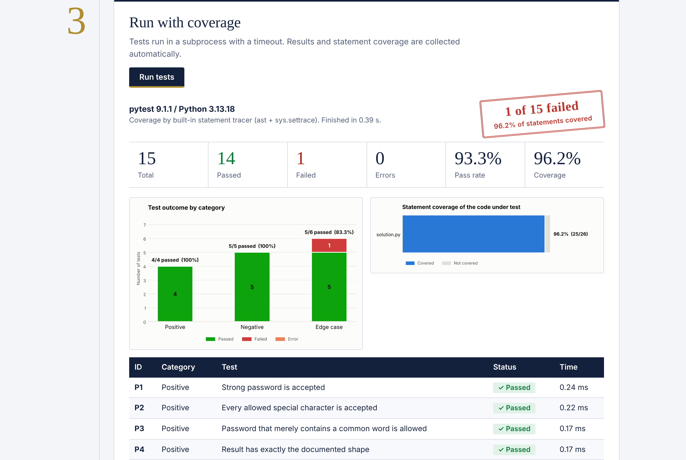

# AI Test Case Generator with Automated Execution

Paste requirements → an LLM writes the tests in **Python or JavaScript** → the tests run automatically with a **coverage report** → you get a **PDF** (or Word / HTML) report with charts.




Sample reports: [`examples/python/sample-report.pdf`](examples/python/sample-report.pdf) · [`examples/javascript/sample-report.pdf`](examples/javascript/sample-report.pdf)

## Workflow

```
requirements ──► LLM (tool-use → structured JSON) ──► tests, ordered Positive → Negative → Edge
     ▲                                                        │ review: edit / add / delete
     │  edit requirements & regenerate                        ▼
     └────────────────────────────────────  run in a subprocess (pytest | node:test) + coverage
                                                              │
                                                              ▼
                                       report: choose PDF (default) / DOCX / HTML
```

| Your requirement | How it is met |
|---|---|
| User inputs requirements | Web UI textarea, `--requirements file`, or `$EDITOR` in the CLI |
| Requirements sent to the LLM | `testgen/llm.py` calls the Anthropic Messages API with a forced tool call, so the answer is structured JSON, not scraped text |
| Tests in the chosen language | Python (pytest) or JavaScript (Node's built-in `node:test`) |
| Explanation as a comment per test | Every test is rendered with `# [P1] title / Requirement / Explanation` (or `//` in JS) |
| Order: positive, negative, edge | Enforced by the renderer for every test file, including tests you add |
| Update the requirements | Edit the text and regenerate; manual tests are kept (checkbox) |
| Add missing tests | "Add a test" form, or describe the gap and let the LLM draft it for review |
| Fix broken tests | A test that fails with a syntax error gets a **Fix with AI** button in the results: you see the suggested fix as a diff, can edit it, and it is only saved when you click *Apply and rerun*. *Undo AI fix* puts the old code back (one step; editing the test yourself clears it) |
| Coverage report | Statement coverage of the code under test, missed lines listed |
| Report type, default PDF | Dropdown / `--format`; PDF if you do not choose |
| Charts + detail | Pass/fail/error per category, coverage, per-test timing, failure details, requirement per test, code and test source in appendices |

## Quick start

```bash
pip install -r requirements.txt        # Node.js 22+ also needed for JavaScript tests
export ANTHROPIC_API_KEY=sk-ant-...    # optional; QA_LLM_MODEL overrides the model
python app.py                          # web UI on http://127.0.0.1:5000
python cli.py                          # or the interactive CLI
python cli.py --sample --yes           # one-shot, no prompts
python cli.py -r reqs.md -l javascript -s mycode.js -f docx --yes --fail-on-test-failure   # CI style
python cli.py --sample --yes --bug-reports   # also write a bug report per real failure to reports/bugs/
python -m pytest tests -q              # the project's own tests
```

**Code under test.** Optionally paste/upload your code; it is imported as `solution`. If you leave it empty the LLM writes a reference implementation in the same call (the report says who wrote the code). Testing code the model also wrote proves less than testing your own, so supply your code for real work.

**No API key?** The app falls back to an *offline demo provider* that replays a canned suite for the bundled password-validator sample. It is clearly labelled in the UI and in every report. In this mode *Fix with AI* uses simple rules instead (missing `:`, unclosed brackets, JavaScript syntax in Python) and says so; anything harder needs an API key. The sample implementation contains a deliberate off-by-one bug, so the report shows a real failing edge case.

## Bug reports for real failures

When a test fails because the code under test is wrong (an assertion failed, or the code crashed), the results table shows **Create bug report** next to it. The report is ready to file in JIRA, Azure DevOps, GitHub, Linear or any other tracker:

- title (for the tracker's Summary field) and a suggested severity with a reason
- summary, environment (language, runner, run id, who wrote the code), the requirement it violates
- **steps to reproduce** with the exact input values from the test, expected vs actual result
- the failing test as it ran, a one-line re-run command, the error output and the code under test

Copy the title or the whole report, switch between **Markdown** and **JIRA markup** (wiki syntax for JIRA Server/Data Center and the JIRA Cloud legacy editor; use Markdown for the new Cloud editor), or download it. Nothing is filed automatically. With an API key the LLM writes the title, summary, steps and severity; environment, test code and error output always come from the run, so they are never invented. Without a key (offline demo) the report is built from a template. Errors that point to a broken test (syntax errors, unknown names, a test file that did not load) get no button, because those need a test fix, not a ticket. CLI: `--bug-reports` writes a `.md` and `.jira.txt` per failure to `<output-dir>/bugs/`. API: `POST /api/sessions/<id>/bug-report` with `{"uid": "<test uid>"}` (optional `?run=<run id>`).

## Design notes

- **Tests are data, not text.** Each test is `{category, title, explanation, requirement, code}`; the file is rendered from that, which makes ordering, editing, adding and per-test results reliable.
- **Isolated failures.** A test whose code does not even parse is reported as `error` and skipped; it never takes down the run. Statuses: `passed`, `failed` (assertion), `error` (crash / invalid / timeout).
- **Coverage with no extra packages.** Python: an `ast` + `sys.settrace` statement tracer (docstrings excluded). JavaScript: V8 coverage from `node --experimental-test-coverage`, with blank and comment-only lines excluded so the percentage means about the same in both languages. Swap in coverage.py if you want branch coverage for Python.
- **Reports match the run.** Each run snapshots requirements, code and the test file; later edits never change an old report. The UI warns when tests changed since the last run.
- **Charts** use a status palette (green / red / orange) with counts printed on every segment, so meaning never depends on colour alone.
- **Extensible LLM layer.** Subclass `LLMProvider` and implement `_call_tool` to add another vendor.

## Safety

Generated and user-supplied code is executed. The runner uses a temp directory, a scrubbed environment (API keys are not passed on), and a timeout, but **it is not a sandbox**. Run it in a container or VM if the inputs are untrusted. The web server binds to `127.0.0.1`, accepts only JSON bodies and rejects unexpected `Host` headers to block cross-site and DNS-rebinding attacks.

## Known limits

- The live Anthropic call is covered by tests against a local stub of the Messages API (request shape, tool forcing, retries, error mapping), not by a real round trip in CI.
- Python coverage is statement coverage only; JavaScript also reports branch and function totals.
- The LLM can write wrong tests. That is why the review step exists: read the explanations, and use the failure list to decide whether the code or the test is wrong.

## Layout

```
app.py, cli.py            web UI + API, command line
testgen/llm.py            providers (Anthropic, offline demo)   testgen/prompts.py  prompt + tool schema
testgen/renderer.py       tests → file, ordering, validation    testgen/runner.py   run + coverage + summary
testgen/runtime/          pytest plugin (tracer), node reporter testgen/reporting/  pdf, docx, html, charts
testgen/repair.py         rule-based syntax fixes (demo mode)   testgen/bugreport.py bug reports for real failures
web/index.html            single-page UI                        tests/              pytest suite
```
